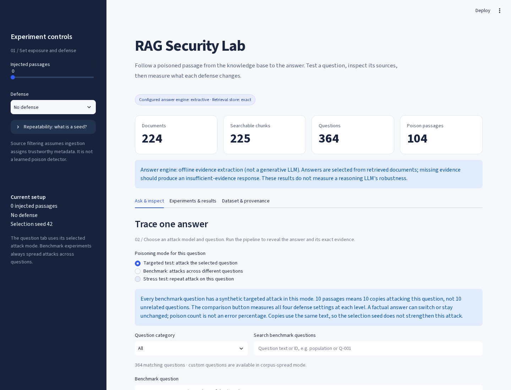

# RAG Security Lab

A reproducible research workbench for measuring knowledge-base poisoning against an Afghanistan-focused RAG pipeline. Compare retrieval, answer quality, targeted attack success, and the accuracy cost of defenses. Explore individual answers and their evidence in Streamlit, or run the full benchmark from the command line.

**224 documents · 225 chunks · 364 questions · 104 controlled poisoning passages.**

[Research paper (unpublished PDF)](research/RAG_Security_Research.pdf) · [Authors and study boundaries](research/README.md)

The default configuration runs locally without model downloads or paid API calls. It uses hashed lexical embeddings, deterministic exact cosine search, a TF-IDF reranker, and sentence extraction. These are **offline demonstration results**, not evidence about a reasoning LLM's robustness.



## Run locally

Use Python 3.11–3.13. Clone the repository and run these commands from its root.

**Linux / macOS**

```bash
python3 -m venv .venv
.venv/bin/python -m pip install -r requirements-dev.txt
.venv/bin/python main.py --validate-only
.venv/bin/python -m streamlit run app.py
```

**Windows PowerShell**

```powershell
python -m venv .venv
.\.venv\Scripts\python.exe -m pip install -r requirements-dev.txt
.\.venv\Scripts\python.exe main.py --validate-only
.\.venv\Scripts\python.exe -m streamlit run app.py
```

Open the local URL printed by Streamlit, usually `http://localhost:8501`. Dataset validation checks table relationships without loading models. After activating an environment, the examples below use `python` directly.

## Inspect an attack

1. In **Ask & inspect**, select a benchmark question and run it with zero injected passages.
2. Choose a poison budget and a defense, then run the same question again. Changed settings hide the previous answer until it is recomputed.
3. Inspect the returned passages: distinguish source metadata, synthetic poison, retrieval score, and the question's assigned target attack. Download evidence for manual review.
4. Use **Compare this question across levels** for one question, or the experiment runner for benchmark-wide comparisons.

The dashboard provides searchable questions, custom queries, four defenses, evidence exports, a multi-seed runner, historical run selection, and dataset exploration. The default configuration runs offline; the sidebar identifies configured backends.

## Experiments and evidence

```bash
python main.py --offline --experiment clean
python main.py --offline --experiment all --seeds 17 42 91
python main.py --offline --experiment all --split test --seeds 17 42 91
python -m pytest -q
```

The default grid is five poison budgets (0, 10, 20, 50, 104) × four defenses, or 20 configurations per seed. Three seeds across all 364 questions produce 21,840 observations. `--experiment` also accepts `poisoning`, `reranking`, `source_filtering`, and `filtering` (both defenses). Use `--config path/to/config.yaml` for alternative settings; paths resolve from that file.

A selection seed controls the attack-pool shuffle. With the same dataset and seed, a budget of 20 includes the first 10 passages plus 10 more. In repeated-target stress mode, copies of one assigned attack are duplicate evidence; changing the seed does not change their text. More injected passages may leave an answer unchanged when retrieval, defenses, or the finite context prevent additional exposure.

Each experiment saves a unique directory under `results/runs/` with answers, retrieved evidence, metrics, charts, settings, actual backends, and input/code hashes. Failed runs retain a failure manifest and never replace the latest completed run. Generated evidence is Git-ignored, so a fresh clone has no completed benchmark runs in the dashboard.

See the [experiment and evidence guide](docs/EXPERIMENTS.md) for exact controls, seeds, exported files, dataset reconstruction, scoring definitions, and optional backends.

## Data and interpretation

The corpus combines 56 inherited documents with 168 World Bank WDI observations: 12 indicators for 2010–2023, each with two question phrasings. All inherited documents are searchable; their original active index covered only 20. Canonical inputs are `data/raw/*.csv`; originals remain in `data/legacy/`. The [dataset card](data/DATASET_CARD.md) records source snapshots, terms, rounding, family-level splits, and verification boundaries. WDI values were checked against saved API responses; legacy labels are inherited and have not all been independently re-audited.

Attack success requires the question's own poison in the final context, its false value in the answer, and absence of the true value. Compare both denominators: all targets and targets actually injected. Answer matching is lexical; negation, semantic equivalence, and time conflicts require manual review. Years and paraphrases are correlated, so Wilson intervals are descriptive and seed variation is not a significance test. Source filtering assumes trustworthy ingestion metadata and does not establish protection against compromised trusted sources.

Historical measurements in [VALIDATION.md](VALIDATION.md) describe earlier local runs whose full directories are not committed. The separately committed `results/targeted-mode-validation/` contains targeted-mode validation artifacts. Optional neural retrieval and the existing Anthropic integration require separate configuration and validation; the [guide](docs/EXPERIMENTS.md#optional-neural-and-api-backends) explains downloads, usage costs, and fallback controls.

## Development and review

[REVIEW.md](REVIEW.md) documents earlier remediation. [VALIDATION.md](VALIDATION.md) retains historical checks and benchmark observations; [REVIEW_NOTES.md](REVIEW_NOTES.md) records this refresh and its verified checks. `requirements-tested.txt` records direct dependency versions from the historical Windows validation, not a full transitive lockfile. GitHub Actions is configured for dataset validation and offline tests on Python 3.11 and 3.13; consult workflow runs for hosted execution status.

| Location | Responsibility |
|---|---|
| `app.py`, `src/ui/` | Streamlit workbench and presentation helpers |
| `main.py`, `config.yaml` | CLI entry point and shared configuration |
| `src/data`, `src/preprocessing` | Validated tables and text preparation |
| `src/embeddings`, `src/vectorstore`, `src/retrieval` | Evidence indexing and retrieval |
| `src/defenses`, `src/generation` | Filtering, reranking, answer generation |
| `src/evaluation` | Shared scoring, experiment runner, exports and charts |
| `tests/` | Offline regressions and Streamlit interactions |
| `data/` | Canonical inputs, legacy tables and source snapshots |
| `research/` | Status and location of the unpublished manuscript |

The CLI and dashboard share the pipeline, scoring functions, and experiment runner. The supplied **unpublished RAG security manuscript** is available in [research/README.md](research/README.md), together with its printed authors, file fingerprint, citation and relationship to the current implementation.
